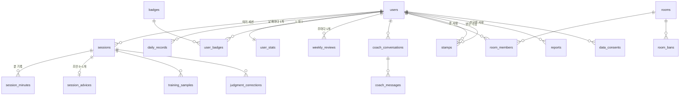

# Zoner v2 도메인·DB 설계

- 작성일: 2026-10-04
- 상태: 확정 (2026-10-04)
- 앞 문서: `01-requirements.md`
- 기준 DB: PostgreSQL (고른 이유는 `04-architecture.md` 3절, `adr/001`)
- 2026-10-12 추가: `refresh_tokens` 테이블(4.1), `idx_rooms_name`(4.5). `03-api.md` 12절에서 넘어온 것

순서: 1 개념 → 2 관계 → 3 규칙 → 4 테이블 → 5 어려운 부분

---

## 1. 개념 목록

| 개념               | 나온 요구사항        | 메모                                        |
| ------------------ | -------------------- | ------------------------------------------- |
| 사용자             | F-101~104            | 이메일, 비밀번호, 닉네임, 하루 목표는 칸    |
| 세션               | F-301~306, F-401~403 | 공부 방식, 점수, 지운 시각(휴지통)은 칸     |
| 분 기록            | F-302                | 5초 판정을 1분 단위로 묶은 것. 이유는 5.1   |
| 하루 기록          | F-501~503            | 날짜별 순 집중 시간, 그날의 목표, 달력 뱃지 |
| 사용자 통계        | F-503, F-804         | 연속 기록, 누적 시간, 도장 수. 이유는 5.3   |
| 업적 뱃지 종류     | F-504                | 어떤 뱃지가 있는지                          |
| 받은 업적 뱃지     | F-504, F-505         | 누가 언제 받았는지                          |
| AI 조언            | F-601                | 세션에 붙는 글                              |
| 주간 돌아보기      | F-602, F-603         | 돌아보기와 다음 주 계획                     |
| 코치 대화 / 메시지 | F-604, F-605         |                                             |
| 방                 | F-701~703            | 공개 여부, 정원, 초대 코드, 방장은 칸       |
| 방 참여            | F-703~708            | 사용자와 방을 잇는 것                       |
| 방 입장 금지       | F-706                | 내보낸 사람이 바로 다시 들어오는 걸 막는다  |
| 신고               | F-707                |                                             |
| 칭찬 도장          | F-801~804            | 누가 누구에게 언제                          |
| 수집 동의          | F-901, F-902         | 동의한 시각, 철회한 시각                    |
| 학습 샘플          | F-901                | 얼굴 좌표 흐름                              |
| 틀린 구간 표시     | F-903                | 순위·뱃지에는 반영 안 함                    |

처음 목록에서 바뀐 것

- 목표는 따로 두지 않는다. 현재 목표는 사용자의 칸으로, 지난 날의 목표는 하루 기록에 그날 값으로 복사해 둔다. 이러면 목표를 바꿔도 지난 뱃지가 안 바뀐다(F-202).
- 판정은 한 건씩 저장하지 않고 분 기록으로 묶는다(5.1).

저장하지 않는 것

| 항목              | 이유                                                                           |
| ----------------- | ------------------------------------------------------------------------------ |
| 리포트 지표       | 세션과 분 기록에서 계산한다. 저장하면 계산식을 고칠 때 옛 값이 틀려진다        |
| 휴지통            | 세션의 지운 시각 칸이다                                                        |
| 방 안 순위        | 하루 기록을 읽어서 정렬한다(5.4)                                               |
| 방 안의 지금 상태 | 몇 초마다 바뀌고 꺼지면 의미가 없다. DB가 아니라 메모리에 둔다(4단계에서 정함) |

---

## 2. 관계



눈여겨볼 관계

| 관계                    | 종류              | 설명                                                                                                                    |
| ----------------------- | ----------------- | ----------------------------------------------------------------------------------------------------------------------- |
| 사용자와 방             | 여럿 대 여럿      | 가운데에 `room_members`를 둔다                                                                                          |
| 사용자와 업적 뱃지 종류 | 여럿 대 여럿      | 가운데에 `user_badges`를 둔다. (사용자, 뱃지)를 기본 키로 잡아서 같은 뱃지를 두 번 못 받게 한다                         |
| 사용자와 칭찬 도장      | 1 대 여럿이 두 개 | 도장 한 건에 사용자가 둘(준 사람, 받은 사람) 엮인다. 같은 테이블을 두 번 가리킨다                                       |
| 방과 방장               | 방의 칸           | `room_members`에 역할 칸을 두지 않고 `rooms.owner_id` 하나로만 둔다. 방장이 누구인지 적힌 곳이 두 군데면 어긋날 수 있다 |

---

## 3. 규칙

요구사항 10장에서 미뤄둔 값이다. 전부 추천값이고 바꿀 수 있다.

| 번호 | 규칙                        | 값                                                                        | 이유                                                     |
| ---- | --------------------------- | ------------------------------------------------------------------------- | -------------------------------------------------------- |
| R-01 | 하루가 바뀌는 시각          | 새벽 5시 (한국 시간)                                                      | 새벽 2시까지 공부한 건 그날 기록이어야 한다              |
| R-02 | 세션이 5시를 넘기면         | 분 단위로 각 날짜에 나눠 넣는다                                           | 세션 전체를 한쪽에 넣으면 하루가 부풀려진다              |
| R-03 | 하루 목표 범위              | 30분 ~ 16시간, 30분 단위                                                  |                                                          |
| R-04 | 달력 뱃지 등급              | 달성률 100% 이상 금, 70% 이상 은, 40% 이상 동, 그 아래는 없음             | 목표를 못 채운 날에도 남는 게 있어야 안 좋은 날에도 켠다 |
| R-05 | 연속 기록                   | 금을 받은 날이 이어진 일수                                                | 목표를 채웠다는 뜻이 분명해야 한다                       |
| R-06 | 닉네임                      | 2~12자, 겹치지 않음                                                       |                                                          |
| R-07 | 방 정원                     | 2~30명, 기본 10명                                                         | 순위를 한 화면에서 볼 수 있는 크기                       |
| R-08 | 한 사람이 들어갈 수 있는 방 | 5개까지                                                                   |                                                          |
| R-09 | 내보낸 사람                 | 그 방에 다시 못 들어온다                                                  |                                                          |
| R-10 | 방장이 나가거나 탈퇴하면    | 가장 먼저 들어온 사람이 방장. 혼자였으면 방이 없어진다                    |                                                          |
| R-11 | 도장                        | 하루 5개, 같은 사람에게 하루 1번, 자기 자신에게 못 줌, 같은 방 사람에게만 |                                                          |
| R-12 | 신고 사유                   | 닉네임·방 이름 문제 / 도장 도배 / 기타                                    | 채팅이 없어서 신고할 일이 적다                           |
| R-13 | 신고 처리                   | 운영자가 DB에서 직접 확인. 관리 화면은 안 만든다                          | 1차 범위를 줄인다                                        |
| R-14 | 같은 신고                   | 같은 사람을 24시간 안에 다시 신고 못 함                                   |                                                          |
| R-15 | 휴지통                      | 30일 뒤 자동으로 완전히 지운다                                            |                                                          |
| R-16 | 탈퇴                        | 바로 전부 지운다                                                          | N-03                                                     |
| R-17 | 동시에 진행 중인 세션       | 한 사람에 하나                                                            |                                                          |
| R-18 | 방에서 보이는 상태          | 집중 중 / 쉬는 중 / 자리 비움 / 측정 안 함                                | 측정을 안 켠 사람을 나타낼 값이 필요해서 하나 추가       |

업적 뱃지 목록 (R-19)

| 종류              | 조건                                |
| ----------------- | ----------------------------------- |
| 시작              | 첫 세션 완료                        |
| 누적 순 집중 시간 | 10 / 50 / 100 / 500 / 1,000시간     |
| 연속 기록         | 7 / 30 / 100일                      |
| 높은 점수         | 60분 이상 세션에서 집중도 90점 이상 |
| 받은 도장         | 10 / 50 / 100개                     |
| 준 도장           | 10 / 50개                           |

높은 점수 뱃지에 60분 조건을 붙인 건 짧게 하고 점수만 따는 걸 막기 위해서다.

---

## 4. 테이블

공통 규칙

- 기본 키는 `uuid`. 순서대로 늘어나는 숫자는 주소에 드러나면 남의 것을 추측할 수 있다
- 시각은 전부 `timestamptz`. 날짜(`day`)는 R-01 기준으로 계산한 값이다
- 이름은 소문자와 밑줄, 테이블은 복수형

### 4.1 계정

```sql
create table users (
  id                 uuid primary key default gen_random_uuid(),
  email              text not null unique,
  password_hash      text not null,
  nickname           text not null unique check (char_length(nickname) between 2 and 12),
  daily_goal_seconds int  not null default 21600
                     check (daily_goal_seconds between 1800 and 57600),
  review_weekday     smallint not null default 1 check (review_weekday between 0 and 6),
  created_at         timestamptz not null default now(),
  updated_at         timestamptz not null default now()
);

create table user_stats (
  user_id                 uuid primary key references users(id) on delete cascade,
  total_net_focus_seconds bigint not null default 0,
  current_streak          int not null default 0,
  longest_streak          int not null default 0,
  last_gold_day           date,
  stamps_received         int not null default 0,
  stamps_given            int not null default 0,
  updated_at              timestamptz not null default now()
);
```

비밀번호는 원문을 저장하지 않고 해시만 저장한다. 이메일 대소문자를 어떻게 다룰지는 구현 때 정한다.

```sql
create table refresh_tokens (
  id         uuid primary key default gen_random_uuid(),
  user_id    uuid not null references users(id) on delete cascade,
  token_hash text not null unique,
  expires_at timestamptz not null,
  revoked_at timestamptz,
  created_at timestamptz not null default now()
);
create index idx_refresh_tokens_user on refresh_tokens (user_id);
```

갱신 토큰(`03-api.md` 1.5절)은 원문을 쿠키에만 두고 DB에는 해시만 둔다. DB가 새어 나가도 토큰을 못 쓰게 하려는 것이다.
`POST /auth/refresh`가 올 때마다 새 줄을 넣고 옛 줄에 `revoked_at`을 찍는다. 로그아웃도 `revoked_at`을 찍는 것이다.
이미 `revoked_at`이 찍힌 토큰이 다시 오면 누가 훔쳐 쓰는 것일 수 있으니 그 사용자의 토큰을 전부 폐기한다.
만료되거나 폐기된 줄은 예약 작업이 지운다 (`04-architecture.md` 6절).

### 4.2 측정

```sql
create table sessions (
  id                 uuid primary key default gen_random_uuid(),
  user_id            uuid not null references users(id) on delete cascade,
  study_mode         text not null check (study_mode in ('book', 'screen', 'lecture')),
  judge_version      text not null,
  started_at         timestamptz not null,
  ended_at           timestamptz,
  measured_seconds   int not null default 0,
  net_focus_seconds  int not null default 0,
  paused_seconds     int not null default 0,
  focus_score        int check (focus_score between 0 and 100),
  alert_count        int not null default 0,
  deleted_at         timestamptz,
  created_at         timestamptz not null default now()
);

create unique index uq_sessions_one_active on sessions (user_id) where ended_at is null;
create index idx_sessions_user_started on sessions (user_id, started_at desc) where deleted_at is null;
create index idx_sessions_trash on sessions (deleted_at) where deleted_at is not null;

create table session_minutes (
  session_id     uuid not null references sessions(id) on delete cascade,
  minute_index   int  not null check (minute_index >= 0),
  minute_start   timestamptz not null,
  total_ticks    smallint not null check (total_ticks between 0 and 12),
  focused_ticks  smallint not null check (focused_ticks between 0 and total_ticks),
  reason_counts  jsonb not null default '{}',
  primary key (session_id, minute_index)
);
```

| 칸                                   | 설명                                                                                                                    |
| ------------------------------------ | ----------------------------------------------------------------------------------------------------------------------- |
| `judge_version`                      | 어떤 판정기로 잰 세션인지. 2차에서 모델을 바꿔도 옛 세션과 구분된다                                                     |
| `ended_at`                           | 비어 있으면 진행 중. `uq_sessions_one_active`가 R-17을 DB에서 막는다                                                    |
| `net_focus_seconds`, `focus_score`   | 분 기록에서 계산할 수 있지만 세션이 끝날 때 한 번 적어 둔다. 끝난 세션은 안 바뀌고 목록에서 매번 읽기 때문이다          |
| `reason_counts`                      | `{"head_turned": 3, "absent": 1}` 같은 사유별 횟수. 판정기가 바뀌면 사유 종류가 달라질 수 있어서 칸으로 고정하지 않는다 |
| `(session_id, minute_index)` 기본 키 | 같은 분이 두 번 와도 한 줄만 남는다. 끊겼다가 다시 보내도 안전하다(N-07)                                                |

### 4.3 하루 기록과 뱃지

```sql
create table daily_records (
  user_id            uuid not null references users(id) on delete cascade,
  day                date not null,
  net_focus_seconds  int  not null default 0,
  goal_seconds       int  not null,
  badge_tier         text check (badge_tier in ('bronze', 'silver', 'gold')),
  closed_at          timestamptz,
  primary key (user_id, day)
);

create table badges (
  code        text primary key,
  category    text not null,
  name        text not null,
  description text not null,
  threshold   int  not null,
  sort_order  int  not null
);

create table user_badges (
  user_id    uuid not null references users(id) on delete cascade,
  badge_code text not null references badges(code),
  earned_at  timestamptz not null default now(),
  primary key (user_id, badge_code)
);
```

| 칸                        | 설명                                                                           |
| ------------------------- | ------------------------------------------------------------------------------ |
| `goal_seconds`            | 그날 첫 기록이 생길 때의 목표를 복사한다. 이후 목표를 바꿔도 이 값은 안 바뀐다 |
| `badge_tier`, `closed_at` | 하루가 끝나면(R-01) 예약 작업이 등급을 정하고 닫는다. 닫힌 날은 다시 안 바뀐다 |
| `badges`                  | 뱃지 종류는 코드가 아니라 데이터다. 뱃지를 추가할 때 줄만 넣으면 된다          |
| `user_badges` 기본 키     | 같은 뱃지를 두 번 넣으면 DB가 거절한다(F-504)                                  |

### 4.4 AI 코치

```sql
create table session_advices (
  session_id uuid primary key references sessions(id) on delete cascade,
  advice     jsonb not null,
  model      text  not null,
  created_at timestamptz not null default now()
);

create table weekly_reviews (
  id         uuid primary key default gen_random_uuid(),
  user_id    uuid not null references users(id) on delete cascade,
  week_start date not null,
  review     jsonb not null,
  plan       jsonb not null,
  model      text  not null,
  created_at timestamptz not null default now(),
  unique (user_id, week_start)
);

create table coach_conversations (
  id         uuid primary key default gen_random_uuid(),
  user_id    uuid not null references users(id) on delete cascade,
  title      text not null default '새 대화',
  created_at timestamptz not null default now(),
  updated_at timestamptz not null default now()
);
create index idx_coach_conv_user on coach_conversations (user_id, updated_at desc);

create table coach_messages (
  id              uuid primary key default gen_random_uuid(),
  conversation_id uuid not null references coach_conversations(id) on delete cascade,
  user_id         uuid not null references users(id) on delete cascade,
  role            text not null check (role in ('user', 'assistant')),
  content         text not null,
  created_at      timestamptz not null default now()
);
create index idx_coach_msg_conv on coach_messages (conversation_id, created_at);
create index idx_coach_msg_user on coach_messages (user_id, created_at);
```

`model` 칸은 어떤 AI 모델이 쓴 글인지 남긴다. 모델을 바꾼 뒤 품질을 비교할 때 쓴다.
AI 하루 한도를 어디서 셀지는 API 설계에서 정한다.

### 4.5 스터디 방

```sql
create table rooms (
  id           uuid primary key default gen_random_uuid(),
  name         text not null check (char_length(name) between 2 and 20),
  description  text not null default '',
  is_public    boolean not null,
  invite_code  text not null unique,
  capacity     int not null default 10 check (capacity between 2 and 30),
  member_count int not null default 0 check (member_count between 0 and capacity),
  owner_id     uuid not null references users(id),
  created_at   timestamptz not null default now()
);
create index idx_rooms_public on rooms (created_at desc) where is_public;
create index idx_rooms_name on rooms using gin (name gin_trgm_ops) where is_public;

create table room_members (
  room_id   uuid not null references rooms(id) on delete cascade,
  user_id   uuid not null references users(id) on delete cascade,
  joined_at timestamptz not null default now(),
  primary key (room_id, user_id)
);
create index idx_room_members_user on room_members (user_id);

create table room_bans (
  room_id   uuid not null references rooms(id) on delete cascade,
  user_id   uuid not null references users(id) on delete cascade,
  banned_at timestamptz not null default now(),
  primary key (room_id, user_id)
);

create table reports (
  id             uuid primary key default gen_random_uuid(),
  reporter_id    uuid references users(id) on delete set null,
  target_user_id uuid not null references users(id) on delete cascade,
  room_id        uuid references rooms(id) on delete set null,
  reason         text not null check (reason in ('name', 'stamp_spam', 'other')),
  detail         text not null default '',
  status         text not null default 'open' check (status in ('open', 'resolved', 'rejected')),
  created_at     timestamptz not null default now()
);
```

`rooms.owner_id`에는 `on delete cascade`를 걸지 않았다. 방장이 탈퇴한다고 방이 통째로 사라지면 안 되고, R-10대로 방장을 넘긴 뒤에 지워야 한다. 이 순서는 서버 코드가 맡는다.
`member_count`는 `room_members`를 세면 나오는 값인데 따로 둔다. 이유는 5.5.
`idx_rooms_name`은 `GET /rooms?q=`의 부분 일치 검색용이다. `pg_trgm` 확장이 필요하므로 첫 마이그레이션에서 `create extension if not exists pg_trgm`을 먼저 한다. 공개 방만 검색되니 `where is_public`을 붙여 인덱스를 작게 유지한다.

### 4.6 칭찬 도장

```sql
create table stamps (
  id          uuid primary key default gen_random_uuid(),
  giver_id    uuid not null references users(id) on delete cascade,
  receiver_id uuid not null references users(id) on delete cascade,
  room_id     uuid references rooms(id) on delete set null,
  day         date not null,
  created_at  timestamptz not null default now(),
  check (giver_id <> receiver_id),
  unique (giver_id, receiver_id, day)
);
create index idx_stamps_giver_day on stamps (giver_id, day);
create index idx_stamps_receiver on stamps (receiver_id, created_at desc);
```

`unique (giver_id, receiver_id, day)`가 "같은 사람에게 하루 한 번"을 DB에서 막는다. 버튼을 두 번 눌러도 두 번째는 거절된다.
"하루 5개"는 제약 조건으로 못 막아서 서버 코드가 센다(5.6).

### 4.7 학습용 데이터

```sql
create table data_consents (
  id           uuid primary key default gen_random_uuid(),
  user_id      uuid not null references users(id) on delete cascade,
  agreed_at    timestamptz not null default now(),
  withdrawn_at timestamptz
);
create unique index uq_consent_active on data_consents (user_id) where withdrawn_at is null;

create table training_samples (
  id           uuid primary key default gen_random_uuid(),
  user_id      uuid not null references users(id) on delete cascade,
  session_id   uuid not null references sessions(id) on delete cascade,
  minute_index int  not null,
  storage_path text not null,
  created_at   timestamptz not null default now(),
  unique (session_id, minute_index)
);

create table judgment_corrections (
  id           uuid primary key default gen_random_uuid(),
  user_id      uuid not null references users(id) on delete cascade,
  session_id   uuid not null references sessions(id) on delete cascade,
  from_minute  int not null,
  to_minute    int not null check (to_minute >= from_minute),
  was_focused  boolean not null,
  created_at   timestamptz not null default now()
);
```

얼굴 좌표 흐름은 크기가 커서 DB에 넣지 않는다. 파일 저장소에 두고 DB에는 위치만 적는다.
동의를 줄 단위로 남기는 건, 언제 동의했고 언제 철회했는지 이력이 필요하기 때문이다.

### 4.8 타임랩스 (F-1001~1005)

```sql
create table timelapses (
  session_id       uuid primary key references sessions(id) on delete cascade,
  user_id          uuid not null references users(id) on delete cascade,
  storage_path     text not null,
  size_bytes       bigint not null check (size_bytes > 0),
  duration_seconds int not null,
  status           text not null default 'pending' check (status in ('pending', 'ready')),
  expires_at       timestamptz not null,
  created_at       timestamptz not null default now()
);
create index idx_timelapses_user on timelapses (user_id, created_at desc);
create index idx_timelapses_expires on timelapses (expires_at);
```

| 항목                   | 설명                                                                                              |
| ---------------------- | ------------------------------------------------------------------------------------------------- |
| 기본 키가 `session_id` | 세션 하나에 타임랩스는 하나다                                                                     |
| `storage_path`         | 영상은 DB가 아니라 파일 저장소에 있다. DB에는 위치와 크기만 적는다                                |
| `status`               | 올리기 시작하면 `pending`, 파일이 다 올라간 걸 서버가 확인하면 `ready`. 올리다 만 파일을 구분한다 |
| `expires_at`           | 올린 시각 + 30일. 예약 작업이 이 칸을 보고 지운다                                                 |

규칙

| 번호 | 규칙                   | 값                                            |
| ---- | ---------------------- | --------------------------------------------- |
| R-20 | 파일 하나의 크기       | 최대 100MB                                    |
| R-21 | 한 사람의 저장 용량    | 1GB                                           |
| R-22 | 보관 기간              | 30일                                          |
| R-23 | 세션을 휴지통에 넣으면 | 타임랩스는 남는다. 완전히 지울 때 같이 지운다 |

주의할 점: 줄을 지워도 파일은 안 지워진다. `on delete cascade`는 DB 안에서만 동작한다. 탈퇴, 세션 완전 삭제, 기한 만료 때 서버가 파일도 따로 지워야 한다. 줄을 먼저 지우고 파일 삭제가 실패하면 주인 없는 파일이 남으므로, 지울 파일을 적어 두고 나중에 다시 시도하는 방법이 필요하다. 이건 4단계에서 정한다.

용량 어림: 설계 기준(하루 3,000명)에서 전원이 타임랩스를 켜고 하나에 30MB라고 치면 하루 90GB, 30일 보관이면 2.7TB다. 무료로는 안 되는 양이다. 실제 사용자는 훨씬 적겠지만, 그래서 한도(R-20~22)를 처음부터 둔다.

---

## 5. 어려운 부분

### 5.1 5초 판정을 어떻게 저장할지

| 방법                          | 하루 줄 수 (하루 3,000명이 평균 5시간) | 판단                                                                                 |
| ----------------------------- | -------------------------------------- | ------------------------------------------------------------------------------------ |
| 판정 한 건마다 한 줄          | 약 1,080만 줄                          | 버림. 한 달이면 3억 줄. 리포트는 분 단위로만 본다                                    |
| 세션 한 줄에 배열로 (v1 방식) | 3,000줄                                | 버림. 세션이 끝나야 저장돼서 중간에 꺼지면 다 날아간다. 방 순위도 실시간으로 못 낸다 |
| 1분마다 한 줄로 묶음          | 약 90만 줄                             | 고름                                                                                 |

브라우저가 5초 판정 12개를 모아 1분에 한 번 보낸다. 서버는 분 기록 한 줄을 넣고, 같은 처리 안에서 하루 기록의 순 집중 시간을 더한다.

- 중간에 꺼져도 마지막 1분만 잃는다 (N-07)
- 같은 분이 두 번 와도 기본 키 때문에 한 줄만 남는다. 다만 하루 기록에 두 번 더하면 안 되므로, 분 기록이 새로 들어갔을 때만 더한다
- 요청 수가 1초에 200건에서 약 17건으로 줄어든다 (N-04)
- 요구사항 6장의 "서버가 받는 건 판정 결과"는 그대로다. 묶어서 보낼 뿐이다

방에서 보이는 상태(집중 중, 자리 비움)는 1분을 기다릴 수 없다(N-06, 2초). 이건 상태가 바뀔 때만 실시간 통로로 따로 보낸다. 저장용 길과 실시간용 길을 나눈 것이다.

분 기록이 계속 쌓이는 문제는 달 단위로 테이블을 나누는 방법(파티션)으로 대비할 수 있다. 처음부터 하지는 않고, 부하 테스트에서 필요가 보이면 넣는다.

### 5.2 세션이 새벽 5시를 넘길 때

분 기록에 `minute_start`가 있어서 분마다 어느 날짜인지 계산할 수 있다. 하루 기록에 더할 때 그 분의 날짜로 더한다(R-02). 세션은 하나지만 하루 기록 두 줄에 나뉘어 들어간다.

### 5.3 연속 기록과 누적 값

연속 기록은 하루 기록을 거꾸로 훑으면 계산할 수 있다. 그런데 마이페이지와 방에서 자주 읽고, 업적 뱃지 조건에서도 쓴다. 그래서 `user_stats`에 적어 둔다.

원칙은 "원본은 하루 기록, `user_stats`는 빨리 읽으려고 둔 복사본"이다. 어긋나면 하루 기록으로 다시 계산해서 고칠 수 있다.

### 5.4 방 안 순위

방 참여자(최대 30명)의 오늘 하루 기록을 읽어 정렬한다. 기본 키 `(user_id, day)`로 바로 찾으므로 30줄 읽는 데 부담이 없다. 따로 저장하거나 캐시하지 않는다.

### 5.5 정원이 한 자리 남았는데 두 명이 동시에 들어올 때

"몇 명인지 세고 → 자리가 있으면 넣는다"를 두 번에 나눠 하면, 둘 다 "한 자리 남음"을 보고 둘 다 들어간다.

```sql
update rooms set member_count = member_count + 1
where id = :room_id and member_count < capacity;
```

세는 것과 늘리는 것을 한 문장으로 한다. 바뀐 줄이 1이면 들어간 것이고 0이면 꽉 찬 것이다. DB가 줄을 잠그기 때문에 두 번째 사람은 첫 번째가 끝난 뒤의 값을 본다. 그다음 같은 처리 안에서 `room_members`에 넣는다. `member_count`를 따로 둔 이유가 이것이다.

### 5.6 도장 하루 5개

"오늘 준 도장을 세고 → 5개 미만이면 넣는다"도 같은 문제가 있다. 준 사람의 `user_stats` 줄을 먼저 잠그고(`select ... for update`) 세면, 같은 사람의 요청이 한 줄로 서서 처리된다.

### 5.7 업적 뱃지를 언제 주는지

분 기록 저장, 세션 종료, 하루 마감, 도장 저장 뒤에 조건을 확인한다. 확인은 `user_stats` 값과 `badges.threshold`를 비교하는 것이고, 주는 건 `user_badges`에 넣는 것이다. 이미 있으면 DB가 거절하므로 여러 번 확인해도 한 번만 받는다.

세션 저장과 뱃지 지급을 어떻게 떼어 놓을지(같이 처리할지, 뒤에서 따로 처리할지)는 4단계에서 정한다.

---

## 6. 요구사항과 맞춰 보기

| 요구사항     | 담당                                                                         |
| ------------ | ---------------------------------------------------------------------------- |
| F-101~104    | `users`. 탈퇴는 `on delete cascade`                                          |
| F-201, F-202 | `users.daily_goal_seconds`, `daily_records.goal_seconds`                     |
| F-301~306    | `sessions`, `session_minutes`                                                |
| F-401~403    | `sessions`, `session_minutes`, `sessions.deleted_at`                         |
| F-501~505    | `daily_records`, `user_stats`, `badges`, `user_badges`                       |
| F-601~605    | `session_advices`, `weekly_reviews`, `coach_conversations`, `coach_messages` |
| F-701~708    | `rooms`, `room_members`, `room_bans`, `reports`                              |
| F-801~804    | `stamps`, `user_stats`                                                       |
| F-901~903    | `data_consents`, `training_samples`, `judgment_corrections`                  |

F-303(알림)은 브라우저에서 일어나고 서버에는 횟수(`alert_count`)만 남는다.
F-704(지금 상태)는 DB에 저장하지 않는다.

## 7. 뒤 단계로 넘기는 것

| 항목                                                               | 정하는 시점    |
| ------------------------------------------------------------------ | -------------- |
| AI 하루 한도 숫자와 세는 곳                                        | API 설계       |
| 방의 지금 상태를 어디에 두는지                                     | 구조·기술 선택 |
| 예약 작업(하루 마감, 주간 돌아보기, 휴지통 비우기)을 뭘로 돌리는지 | 구조·기술 선택 |
| 뱃지 지급을 같이 처리할지 따로 처리할지                            | 구조·기술 선택 |
| 학습 샘플 파일 저장소                                              | 구조·기술 선택 |
| 분 기록 테이블 나누기                                              | 부하 테스트 뒤 |
